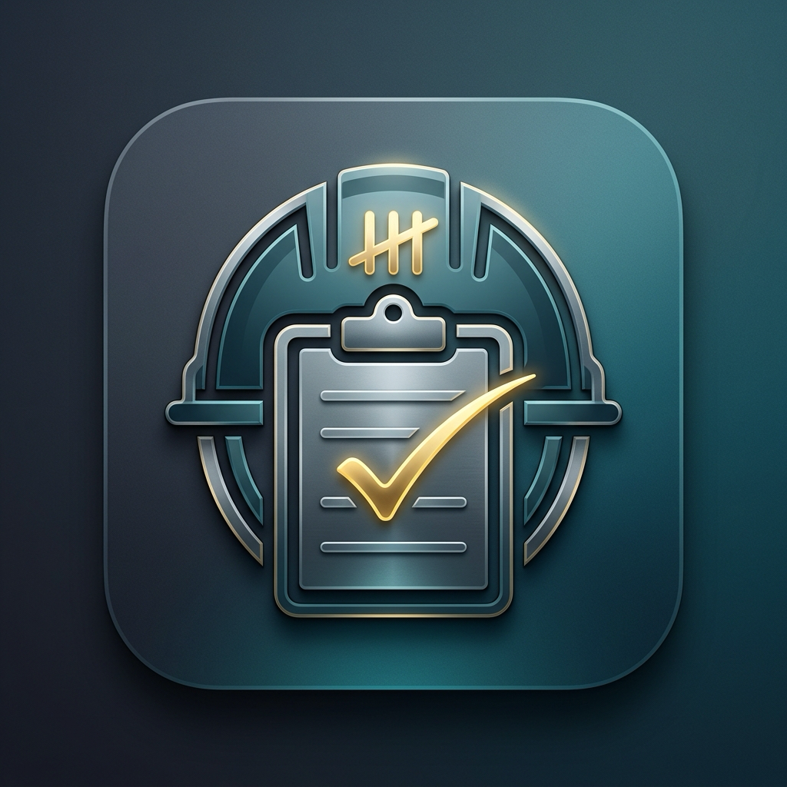
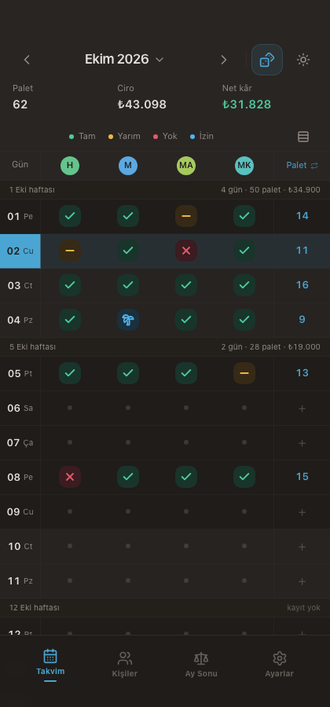
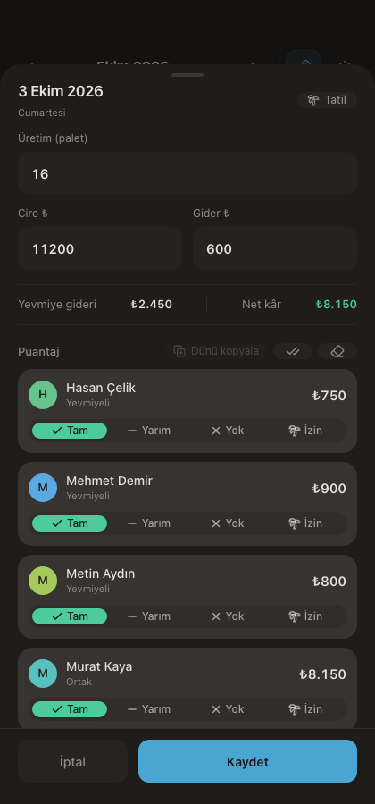
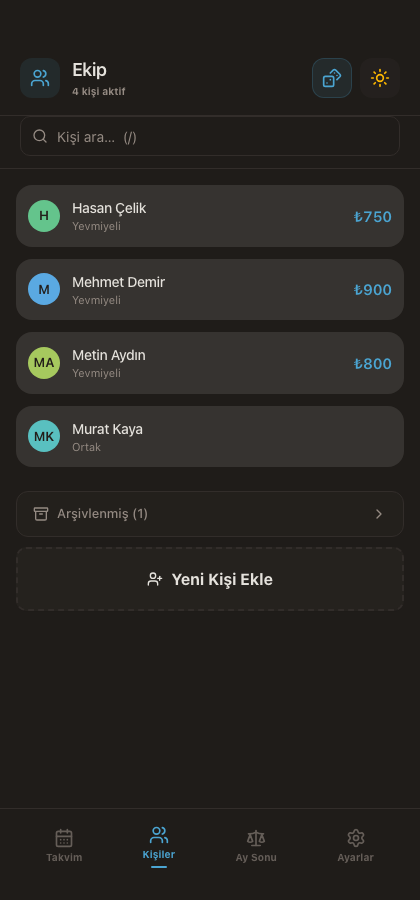
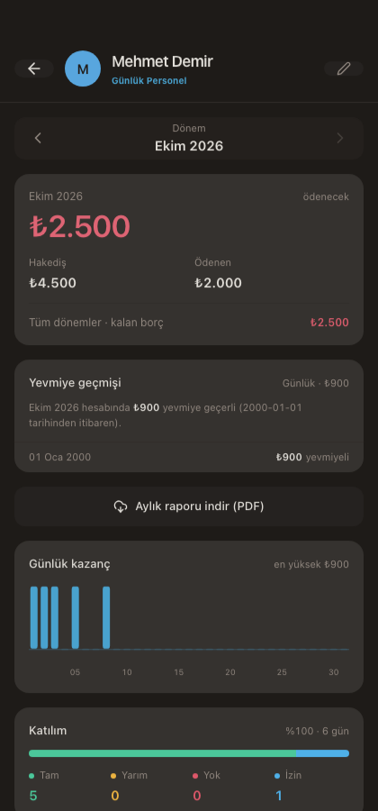
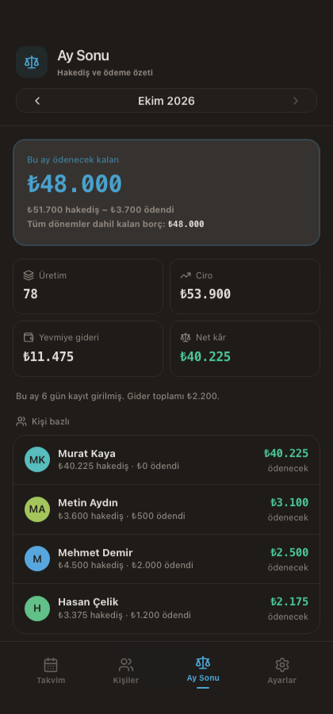
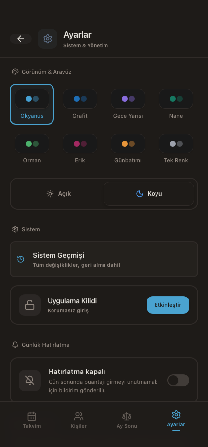
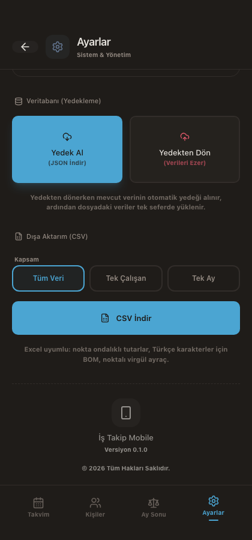
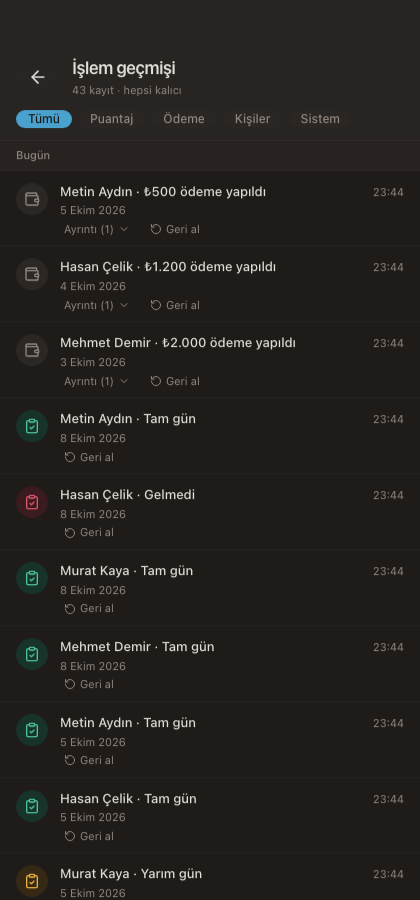

<div align="center">



# İş Takip

**Attendance, production and payroll tracking for construction site crews — one Tauri codebase, five platforms.**

[](https://github.com/mby19/is-takip/actions/workflows/ci.yml)
[](https://github.com/mby19/is-takip/actions/workflows/release.yml)
[](LICENSE)
[](https://v2.tauri.app/)
[](https://react.dev/)
[](https://www.typescriptlang.org/)

</div>

---

## About

İş Takip records the daily attendance, production volume and payments of people
working on a construction or manufacturing site, then turns that into payroll
figures you can actually defend.

Desktop (macOS / Windows / Linux) and mobile (Android / iOS) are **the same
application**, not two codebases that drift apart — the mobile build is a second
output of the Tauri project. The reasoning behind that decision is written up in
[ADR 0010](docs/adr/0010-mobil-hedefi.md).

> **The application interface is currently Turkish-only.** All figures, dates and
> names are entered and displayed with Turkish conventions (dotless/dotted i,
> `₺` currency, `dd.MM.yyyy` dates). This README, `CONTEXT.md`,
> `SECURITY_REPORT.md`, `PRIVACY.md` and the ADRs under `docs/adr/` are written in
> **Turkish**; the code, identifiers and code comments are in English. UI
> localisation (i18n) is on the roadmap.

## Features

- **Crew management** — daily-paid and flat-rate workers, distinguished by colour
  and short label.
- **Daily attendance** — full day, half day, absent; bulk entry for a
  whole day at once.
- **Production metrics** — daily production counts, revenue and expense entry.
- **Payment tracking** — per-worker payment records with running balance.
- **Month-end summary** — business profit, per-worker earnings breakdown and an
  all-time view.
- **Period lock** — a month that has been paid becomes read-only. If the lock
  state cannot be read, the app refuses to write to any period rather than
  guessing.
- **Daily reminder** — notification for days with no attendance entered, batch
  marking straight from the notification, and an `istakip://bugun` deep link.
- **App lock** — emoji pattern plus a recovery PIN, stored as a salted SHA-256
  digest with a 5-attempt / 60-second lockout.
- **Audit log** — every change is recorded automatically by SQLite triggers, with
  undo and undo-of-undo.
- **Error monitoring** — opt-in Sentry with PII masking; fully disabled when no
  DSN is configured.
- **Backup** — versioned JSON backup and restore, with an automatic safety copy
  taken before any restore.
- **Light and dark theme** — follows the system preference.
- **End-to-end tests** — Playwright driving the real app against real
  `node:sqlite`.

## Tech stack

- [Tauri v2](https://v2.tauri.app/) — app framework; desktop **and** mobile targets
- [React 19](https://react.dev/) + [TypeScript](https://www.typescriptlang.org/) — frontend
- [Tailwind CSS v4](https://tailwindcss.com/) — styling
- [SQLite](https://www.sqlite.org/) via [`@tauri-apps/plugin-sql`](https://github.com/tauri-apps/plugins-workspace) — local database
- [Zustand](https://github.com/pmndrs/zustand) — state management
- [jsPDF](https://github.com/parallax/jsPDF) + [jspdf-autotable](https://github.com/simonbengtsson/jspdf-autotable) — PDF reports
- [date-fns](https://date-fns.org/) — date handling
- [Radix UI](https://www.radix-ui.com/) — accessible dialog/sheet primitives
- [Lucide React](https://lucide.dev/) — icon set

There is **no charting library**: the daily earnings chart on a worker's detail
view is hand-drawn with `<svg>` inside `WorkerDetailView`.

## Screenshots

### Daily attendance



### Day detail with bulk entry



### Crew



### Worker detail



### Month-end summary



### Settings





### History



The remaining shots in `docs/screenshots/` (`light-*.png`, `yogunluk-*.png`)
cover the light theme and the density settings at 6, 8 and 10 entries per row.

## Platform support

| Platform | Status                   | Minimum version                                      |
| -------- | ------------------------ | ---------------------------------------------------- |
| macOS    | Built and released in CI | 11.0 (Big Sur) — `bundle.macOS.minimumSystemVersion` |
| Windows  | Built and released in CI | Windows 10 (WebView2 runtime)                        |
| Linux    | Built and released in CI | glibc 2.31+ (`.deb` / `.AppImage`)                   |
| Android  | Built in CI, APK         | Android 7.0 (API 24)                                 |
| iOS      | Builds locally only      | iOS 15.0                                             |

CI builds and uploads macOS (Apple Silicon + Intel), Windows (`.exe` + `.msi`)
and Linux (`.deb` + `.AppImage`) artifacts for every tagged release. The Android
jobs (APK **and** AAB) are gated: they run only if the repository variable
`ANDROID_RELEASE_ENABLED` is `true` **or** the secret `ANDROID_KEYSTORE_BASE64`
is present — see `.github/workflows/release.yml`. Without a release keystore
there is nothing to sign with, so the jobs are skipped rather than silently
falling back to a debug signature. **iOS is not distributed** — see
[Known limitations](#known-limitations).

## System requirements

The app itself is lightweight — it is a SQLite-backed local application with no
server component and no network dependency at runtime.

**To run a released build:**

- macOS 11.0 or later
- Windows 10 or later with the [Microsoft Edge WebView2 runtime](https://developer.microsoft.com/en-us/microsoft-edge/webview2/)
- A glibc 2.31+ Linux distribution
- Android 7.0 (API 24) or later
- iOS 15.0 or later (build from source only)

**To build from source:**

- Node.js 22 (LTS)
- Rust stable via [rustup](https://rustup.rs/)
- Platform toolchain: Xcode Command Line Tools (macOS), Microsoft C++ Build
  Tools + WebView2 (Windows), `libwebkit2gtk-4.1-dev` and friends (Linux)
- Android builds additionally need Android Studio, JDK 17, the Android SDK and
  NDK 27.0.11902837
- iOS builds additionally need full Xcode and CocoaPods

Full per-platform instructions:
[Tauri prerequisites](https://v2.tauri.app/start/prerequisites/).

## Installation

### Pre-built binaries

1. Go to the [Releases page](https://github.com/mby19/is-takip/releases).
2. Download the artifact for your platform
   (`*.dmg`, `*-apple-darwin.app.tar.gz`, `*.msi`, `*.exe`, `*.deb` or
   `*.AppImage`).
3. macOS: open the `.dmg` and drag the app to Applications.
   Windows: run the `.msi` (or the portable `.exe`).
   Linux: `sudo dpkg -i *.deb`, or mark the `AppImage` executable and run it.
4. On first launch the database is created automatically. It is **not** seeded
   with demo data — start by adding your own crew, or import a backup.

> Releases are built from unsigned or ad-hoc signed toolchains unless signing
> secrets are configured for the repository. Expect Gatekeeper and SmartScreen
> warnings on macOS and Windows.

### Android

Download the `.apk` attached to a release and install it on the device. Android
requires you to allow installation from that source the first time.

### iOS

There is no public iOS build. To run it you need macOS with Xcode and a build
from source — see [Development](#development).

### From source

```bash
git clone https://github.com/mby19/is-takip.git
cd is-takip
npm install
npm run tauri dev
```

## Data and privacy

**All your data stays on your device.** The application is fully offline: there
is no account, no server, no telemetry endpoint and no sync. The database is a
local SQLite file created and owned by the app.

- **No sync, no cloud, no account.** Moving data between machines is a manual
  export/import of a JSON backup file.
- **Backups are plain JSON** — readable by anything. Treat them as sensitive:
  they contain names, pay rates and payment records. Store them accordingly.
- **Sentry is optional and off by default.** Error monitoring only activates if
  `VITE_SENTRY_DSN` is set at build time (see `.env.example`). Without a DSN,
  nothing is ever sent anywhere. When it is enabled, personal data is masked
  before the event leaves the device, and it can be turned off at runtime.
- **The app lock is a privacy control, not a security boundary.** The lock hash
  is a salted SHA-256 digest with a 5-attempt / 60-second lockout. The database
  file itself is not encrypted, so anyone with filesystem access to your machine
  can read it.
- **Android backups are disabled** (`allowBackup="false"` plus explicit data
  extraction rules) so that the database cannot be extracted via `adb backup`.

Deleting the app deletes its local database. Export a backup first if you need
the data to survive.

## Development

```bash
# Install dependencies
npm install

# Start the dev server
npm run tauri dev

# Unit tests (Vitest)
npm run test          # or: npx vitest run

# Type check
npm run typecheck     # or: npx tsc --noEmit

# Lint
npm run lint          # eslint src/

# Format
npm run format

# End-to-end tests (Playwright, real SQLite)
npm run test:e2e      # = cd e2e && npm run test:e2e
```

Pre-commit gates run automatically from `.husky/pre-commit`:
`lint-staged` (Prettier + ESLint) → `npm run typecheck` → `npm run test`.

### Building

```bash
npm run tauri build
```

Output lands in `src-tauri/target/release/`.

#### Mobile builds

```bash
npm run tauri android build   # APK/AAB → src-tauri/gen/android/app/build/outputs/apk/
npm run tauri ios build       # Xcode archive (requires macOS + Xcode)
```

The Android project under `src-tauri/gen/android` is generated **and contains
hand-edited files** — `AndroidManifest.xml` with `allowBackup="false"` and the
data extraction rules that implement the privacy decision above. If
`gen/android` is deleted and regenerated, those settings are lost. Verify with
`npx vitest run src/__tests__/androidBackup.test.ts`. The rest of the mobile
setup (deep-link registration, capability scope, the Android manifest) is
pinned by `npx vitest run src/__tests__/mobileReadiness.test.ts`.

### Architecture

Layering rule: `Component → Hook → Store (state) → Repository (SQL) → lib/db.ts`

```
src/
├── components/     # Screens and components (ui/, modal-stack.tsx)
├── hooks/          # useReminders, useTimeouts, useAnimatedCounter
├── stores/         # Zustand stores (state + repository orchestration)
├── repositories/   # The one place SQL lives
├── schema/         # Single source for the audit triggers
├── lib/            # DB connection, schema repair, calculation and presentation helpers
├── utils/          # Pure calculation logic (React-independent)
├── types/          # TypeScript type definitions
├── __tests__/      # Vitest tests
├── App.tsx         # Main application component
└── main.tsx        # Entry point (Sentry setup lives here)
```

The schema is managed in two layers: Rust migrations (`src-tauri/src/db.rs`,
13 of them) own tables and indexes, while `src/lib/schemaGuard.ts` idempotently
fills in anything missing at startup. The audit triggers live on the frontend
side, in `src/schema/triggers.ts`.

### PDF output and Turkish characters

No TTF font is embedded; jsPDF's **built-in** font (`helvetica`, cp1252 /
WinAnsi) is used. This is deliberate: files previously packaged under
`public/fonts/Inter-*.ttf` were not real fonts but error pages, and the resulting
PDFs had broken glyphs.

cp1252 cannot represent several Turkish characters. They are folded to their
readable equivalents:

| In the document | In the source |
| --------------- | ------------- |
| `s`             | `ş`, `Ş`      |
| `g`             | `ğ`, `Ğ`      |
| `i`             | `ı`           |
| `I`             | `İ`           |
| `TL`            | `₺`           |

Only the shape of the letter is lost; **amounts, dates and numbers are
unaffected**. When this conversion runs, a `PDF_FONT_WARNING` line is written at
the bottom of the document so the reader knows why.

For the full domain model and the decision log, see [CONTEXT.md](CONTEXT.md) and
[docs/adr/](docs/adr/index.md).

## Known limitations

Stated plainly, because they will otherwise surprise you:

- **iOS is not distributed.** There is no TestFlight build, no App Store
  submission, and the release workflow does not build an iOS target. The Xcode
  project compiles locally, but code signing and provisioning are not set up, so
  running it on a physical device requires your own Apple Developer account and
  signing setup.
- **No auto-updater.** The updater is switched off in `tauri.conf.json`: the
  plugin, its Rust dependency, the capability grant and the in-app check are all
  absent, so there is no update check at all — you update by installing a new
  release build manually from the Releases page. See
  [`docs/release-rehberi.md`](docs/release-rehberi.md#2-otomatik-güncelleme-updater--ileri-tarihli-şimdilik-kapalı)
  for the wiring steps when it is worth enabling.
- **Release artifacts are unsigned on macOS and Windows** unless signing secrets
  are configured, which means Gatekeeper / SmartScreen friction for end users.
- **No i18n.** The interface is Turkish only.
- **Single-device, single-user.** No accounts, no multi-device sync, no
  concurrent editing.
- **No database encryption at rest.** The app lock is a UI gate, not encryption.
- **Linux packaging is community-tier** (`.deb` + `.AppImage`); there is no
  Flatpak or Snap.
- **PDF output folds Turkish characters** (see above). Amounts and dates are
  exact, but a printed `ş` appears as `s`.

## Roadmap

Roughly, in intent rather than order:

1. iOS signing and a TestFlight/App Store track.
2. Wire up the Tauri updater so desktop builds can self-update.
3. Platform code signing and notarisation for macOS and Windows releases.
4. UI localisation (i18n), starting with English.
5. Encryption at rest for the local database.
6. Optional, user-controlled sync between devices.

## Security

- **[SECURITY.md](SECURITY.md)** — the security policy: how to report a
  vulnerability, which versions receive fixes, and the safe-harbor terms.
- **[SECURITY_REPORT.md](SECURITY_REPORT.md)** (Turkish) — the detailed
  security assessment of the current codebase: what was reviewed, what holds and
  what does not.

Please report security issues privately through the channels in `SECURITY.md`
rather than opening a public issue.

## Contributing

Contributions are welcome. Please read [CONTRIBUTING.md](CONTRIBUTING.md) first
— it covers the setup, the commit conventions, the architecture rules and the
test gates your change has to pass.

## License

Released under the [MIT License](LICENSE). See the license file for the full
text.
